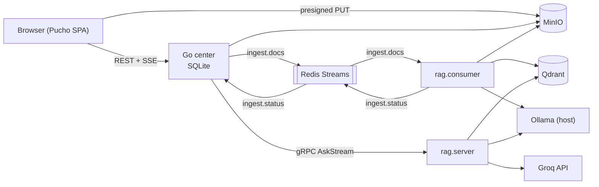

# Pucho (ragPOC)

Pucho ("ask" in Urdu) is a document question-answering proof of concept. You upload PDF, text or
Markdown files in a browser, watch them get indexed, and ask questions. The answer streams back
with its sources.

It is two independent services that meet only at written contracts:

- **Go center** (`services/center`): HTTP API, uploads through presigned MinIO URLs, content
  hashing, a transactional outbox to Redis Streams, the status consumer, and the Ask proxy (gRPC to
  SSE). It also serves the web UI.
- **Python RAG service** (`services/rag-service`): an ingest consumer (parse, chunk, embed with
  Ollama, store in Qdrant) and a gRPC server that retrieves and answers with Groq.
- **Web UI** (`services/web`): a Vite + React + TypeScript single-page app, served by Go from the
  same origin.



Delivery is at-least-once with idempotent consumers. Full diagrams (data model, flows, state
machines, crash windows) are in [docs/architecture.md](docs/architecture.md).

## Data rule

Questions and retrieved chunks are sent to Groq, an external service. Use only public or synthetic
documents, such as `evals/corpus/` and `demo/pucho-demo.pdf`. Never upload client or personal files.

## Prerequisites

- Docker with compose
- [Ollama](https://ollama.com) running on the host, with the embedding model pulled:
  `ollama pull qwen3-embedding:4b`
- A Groq API key, exported in your shell only. Never write it to a file in git.
- For local development and tests: Go, `uv` (Python), Node and npm.

## Run it

```sh
GROQ_API_KEY=... make stack   # the whole system in containers; UI at http://localhost:8080
make demo                     # scripted demo against the running stack (see docs/demo.md)
make down                     # stop the stack, keep its data
make demo-reset               # delete this checkout's stack data after you type `reset`
```

The compose project is named after the checkout folder, and only one stack can run at a time
(ports 8080, 9000, 50051 on `127.0.0.1`). To work on the UI with hot reload against the running
stack: `cd services/web && npm run dev`, then open http://localhost:5173.

## Test

| Command | What it runs |
| --- | --- |
| `make test` | Go unit tests (`-race`), Python `pytest`, web tests and type-checked build |
| `make test-integration` | Go and Python tests against real Redis, Qdrant, MinIO and the gRPC server |
| `make e2e` | The full system in compose with stubbed ingest modes |
| `make e2e-faults` | Failure injection: Redis outages, killed workers, concurrent duplicates |
| `make eval` | Retrieval eval over `evals/corpus` (hit@k; no Groq calls) |

## Host dev loop

`make up` starts only MinIO, Redis and Qdrant. Then `make go_migrate` (SQLite and buckets),
`make run_migrations` (Python SQLite and the Qdrant collection), `make run_worker` and
`make run_server`. See [services/rag-service/README.md](services/rag-service/README.md).

## Repository layout

| Path | Contents |
| --- | --- |
| `services/center` | Go service: `cmd/api`, `internal/*`, SQLite `migrations` |
| `services/rag-service` | Python service: `rag.consumer`, `rag.server`, adapters, tools |
| `services/web` | Web UI source |
| `protos/rag/v1` | gRPC contract (`RagEngineService`) |
| `contracts/events` | Event JSON schemas and golden fixtures shared by both services |
| `deploy` | Compose, e2e and fault-test configs |
| `config.toml` | Shared config for the host dev loop |
| `evals` | Retrieval eval corpus, questions and results |
| `scripts` | e2e, demo and reset scripts |
| `docs` | PRD, architecture, design decisions, demo runbook |

## Docs

- [docs/architecture.md](docs/architecture.md): system, deployment, data model, flows, state
  machines, crash windows
- [docs/design-decisions.md](docs/design-decisions.md): key decisions, their reasoning, and lessons
- [docs/rag-poc-prd.md](docs/rag-poc-prd.md): requirements, contracts, phases and backlog (the
  source of truth)
- [docs/demo.md](docs/demo.md): demo runbook

## Status

Phases 0 to 4 of the PRD are done: walking skeleton, real RAG with an eval (40/40 at rank 1),
hardening and fault e2e, the UI backend, and the web UI. Open items are the PRD section 8 backlog,
led by reconciling documents stuck in `PROCESSING` (B2) and dead-letter replay (B1).
