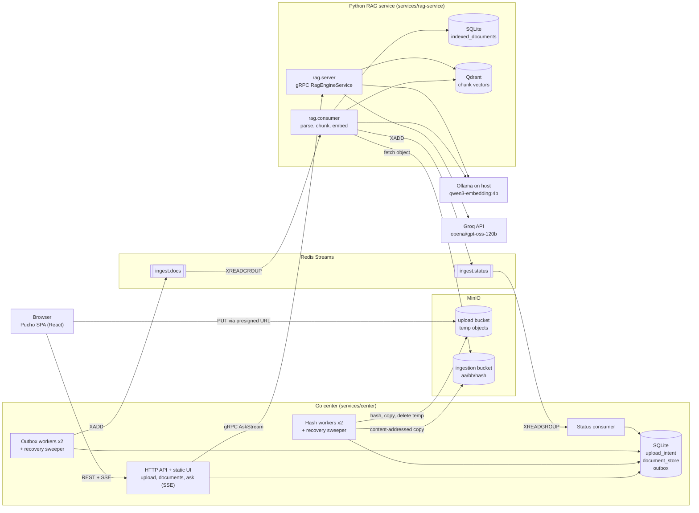
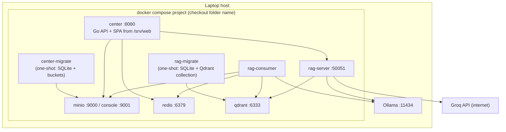
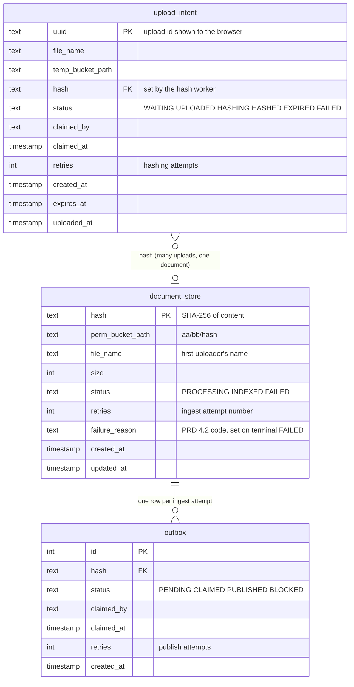
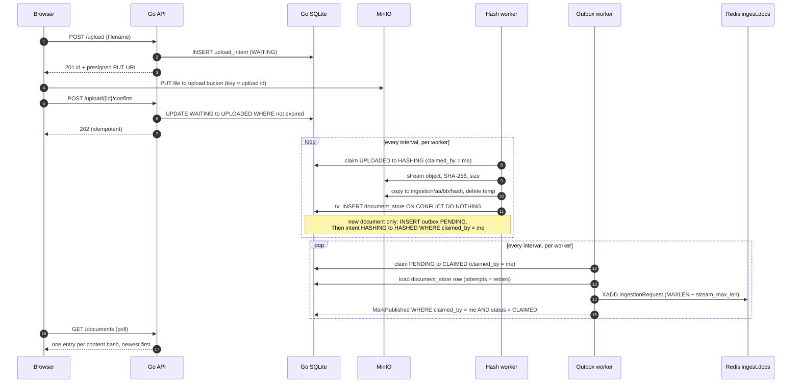
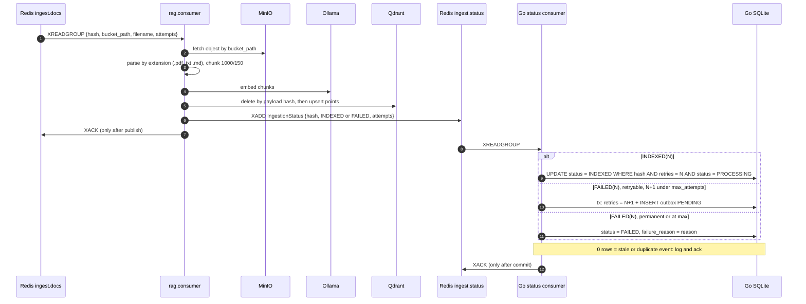
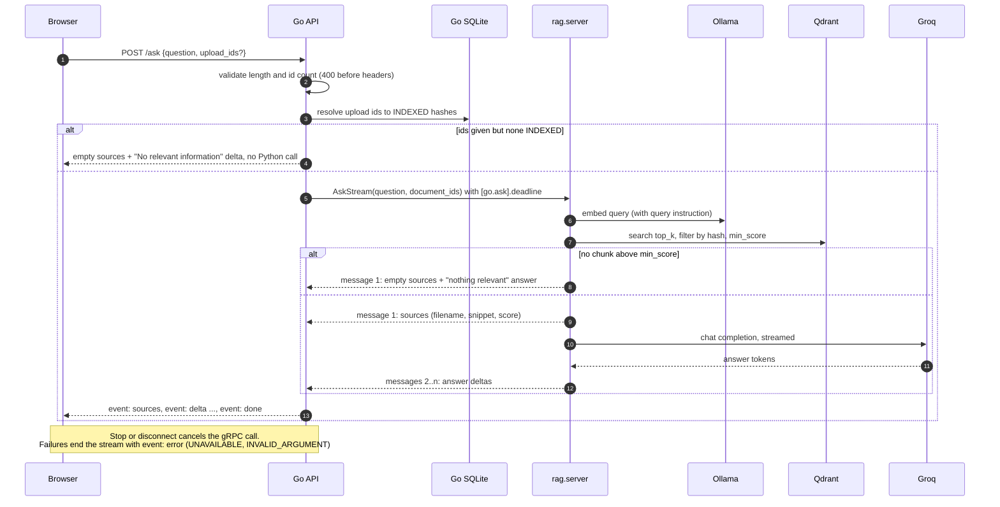
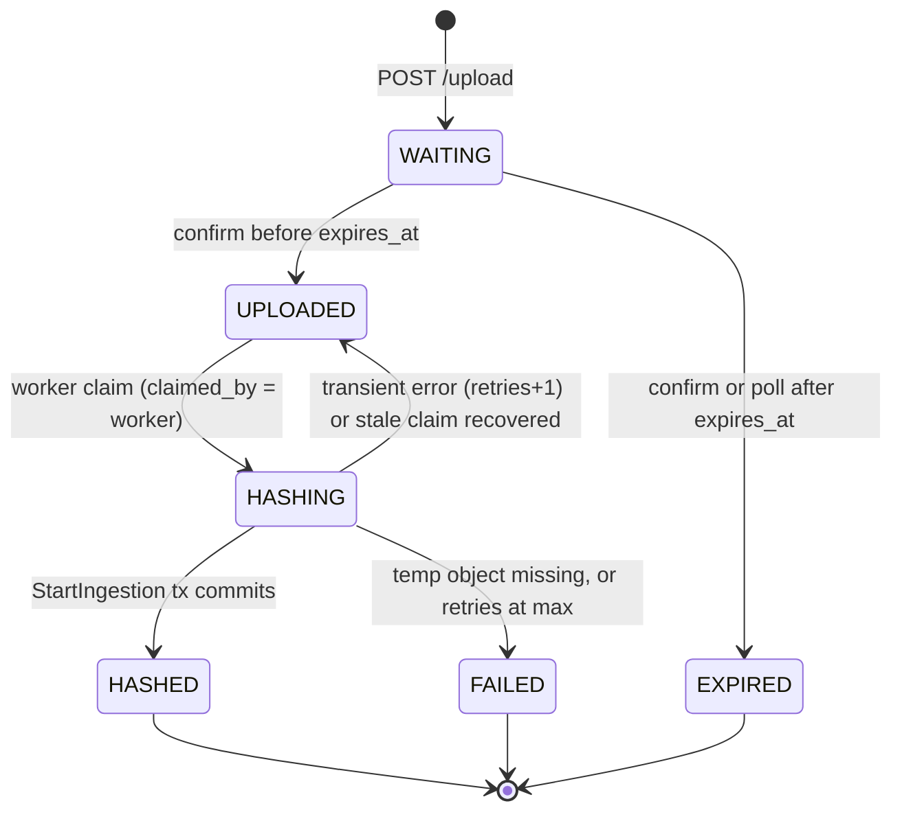
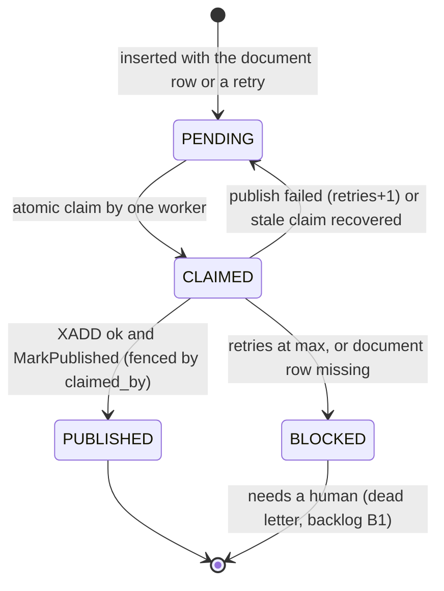
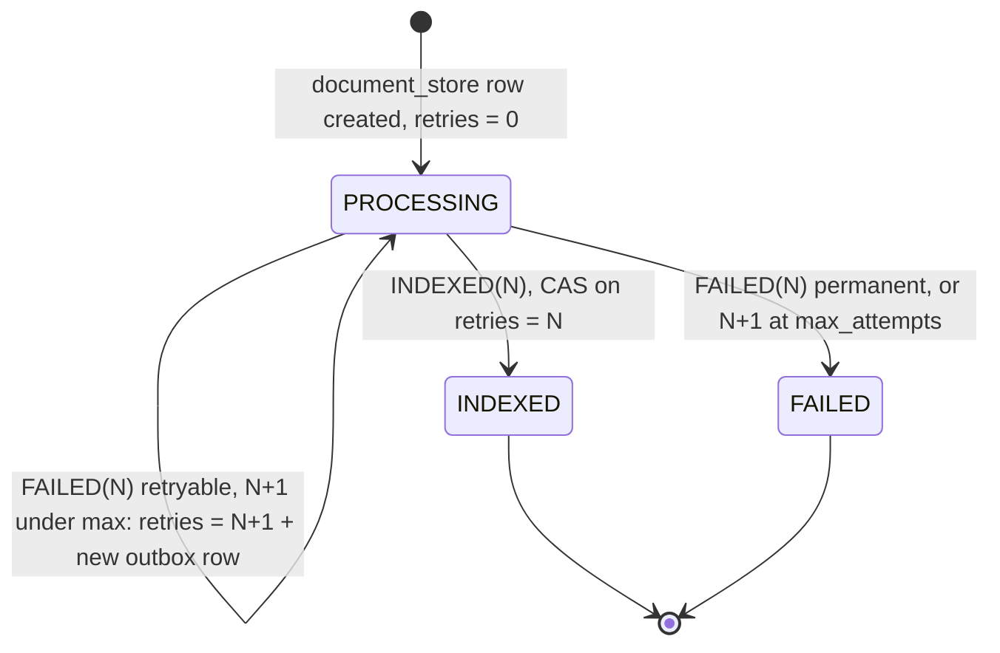
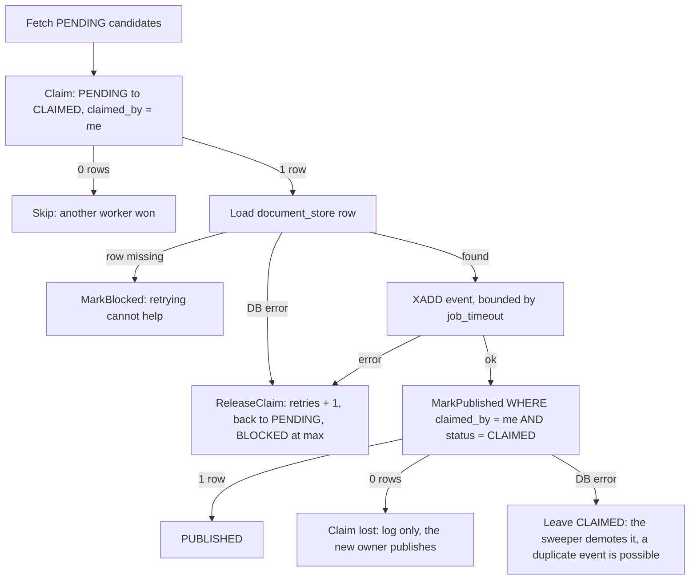

# Pucho architecture

As of 2026-11-20 (main `24eb9f0`, PRD rev 3.1). Pucho is a document question-answering system built
from two independent services: a Go "center" that owns uploads and state, and a Python RAG service
that indexes documents and answers questions. They meet only at the contracts in
[`rag-poc-prd.md`](rag-poc-prd.md) section 4.

The diagrams started in the October design and learning report and are updated here to match the
system as built. Where this page and the PRD differ, the PRD wins.

## 1. System context

Transport rule: gRPC when a live caller waits (asking a question), Redis Streams events when nobody
is blocked (ingest and status). Delivery is at-least-once, and every consumer is idempotent.

## 2. Deployment (docker compose)

All ports bind to `127.0.0.1`. One shared `config.toml` (compose uses `deploy/config.compose.toml`)
configures every service. The only secret passed through the environment is `GROQ_API_KEY`. The
SPA is built by a Node stage in the center image and served from the same origin as the API, so the
Go API needs no CORS. MinIO allows CORS from `:8080` and from the Vite dev server on `:5173`.

## 3. Data model (Go SQLite)

The three `retries` columns count different things: hashing attempts on `upload_intent`, ingest
attempts on `document_store` (sent to Python as `attempts` and echoed back), and publish attempts
on `outbox`. Python keeps its own `indexed_documents` table and never reads Go's database.

## 4. Upload, hash and publish

A duplicate upload is not a failure: its intent links to the existing `document_store` row and
reports that document's status. The UI shows duplicates as one document.

## 5. Ingest and status

Python owns its consumer group on `ingest.docs`; Go owns its group on `ingest.status`. Each job is
bounded by `job_timeout` plus a watchdog, which stays below the `XAUTOCLAIM` `min_idle`, so a live
job is never reclaimed. Entries delivered more than `poison_threshold` times are reported as
`FAILED`, `POISON_MESSAGE`, not retryable.

## 6. Ask (streamed answer)

The browser never sees content hashes. It names documents by upload id, and Go maps them to hashes.

## 7. State machines

### Upload intent

`GET /documents` shows `UPLOADED` and `HASHING` as `PROCESSING`, an intent-level `FAILED` as
`UPLOAD_FAILED`, and hides `WAITING` and `EXPIRED`.

### Outbox

### Document ingestion

### Outbox worker outcomes

Every branch ends in a state a sweep or a human can find. The two duplicate-event branches are
absorbed downstream by the `(hash, attempts)` CAS.

## 8. Crash windows

For every point where a process can die: the state it leaves and the component that repairs it.

| Where the process dies | State left behind | Who repairs it | Cost |
| --- | --- | --- | --- |
| Hash worker, after the copy and before the DB transaction | Object at `aa/bb/<hash>`; intent still `HASHING` | Hash sweeper demotes; the retry copies the same bytes to the same key | Wasted storage at worst (orphan cleanup is backlog B3) |
| Hash worker, while `HASHING` | Stale claim | Hash sweeper: back to `UPLOADED`, or `FAILED` at max | Delay up to `stale_threshold` |
| Outbox worker, after the claim and before `XADD` | Row `CLAIMED`, nothing published | Outbox sweeper demotes to `PENDING` | Delay up to `stale_threshold`; no duplicate |
| Outbox worker, after `XADD` and before `MarkPublished` | Event in the stream, row `CLAIMED` | Outbox sweeper demotes; the event is published again | Duplicate, absorbed by `(hash, attempts)` |
| Redis unavailable | Every publish fails | `ReleaseClaim` spends a retry; `BLOCKED` at max | A human must unblock; nothing lost |
| Python, while processing an entry | Entry pending, no ack | `XAUTOCLAIM` recovery pass reclaims it; past `poison_threshold` it is reported `FAILED` | Redelivery |
| Go, inside the status transaction | Nothing committed | Redelivery applies it once | None |
| Go, after the status commit and before `XACK` | Update applied, entry still pending | Redelivery; the CAS matches 0 rows; the entry is acked | None |
| Python down longer than the stream cap | Oldest events trimmed while the outbox says `PUBLISHED`; document stuck `PROCESSING` | Nothing yet: needs reconciliation (backlog B2) and lag alerting (B4) | Silent until built |

The last row is the largest open risk, because no component notices it.
