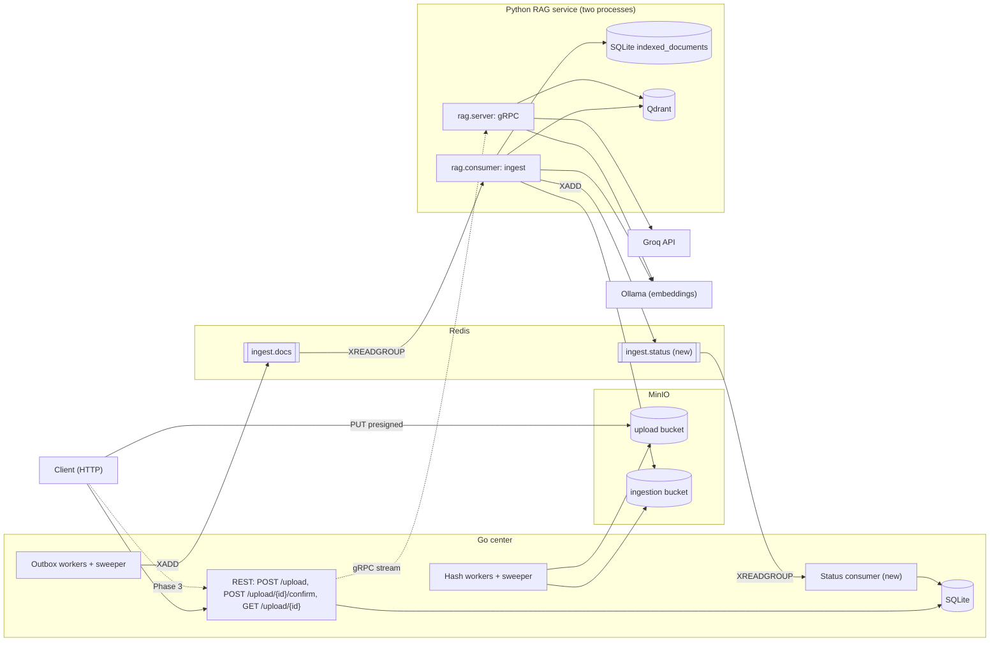
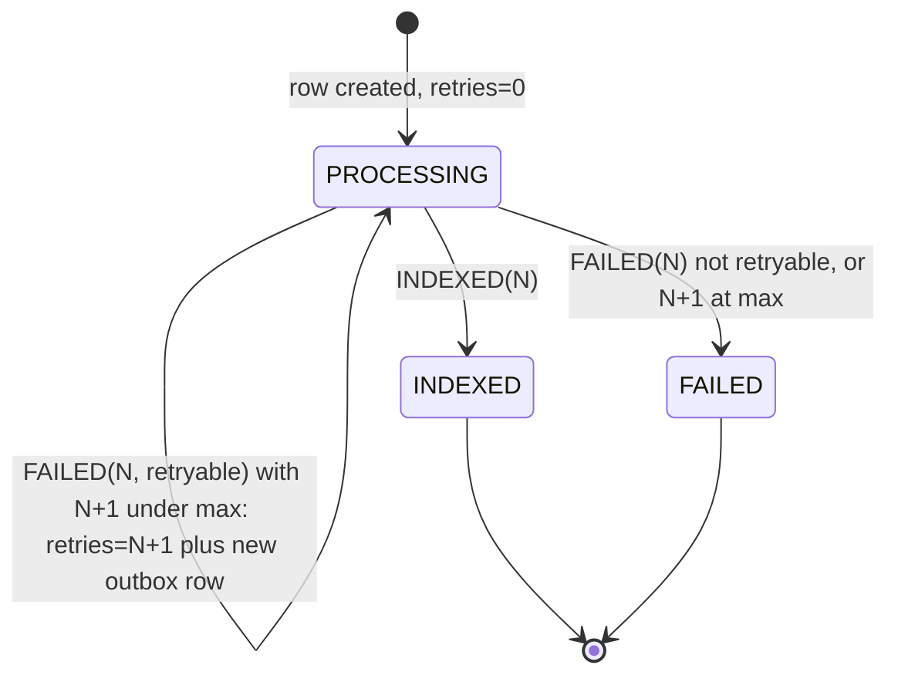

# RAG POC: Product Requirements Document

Date: 2026-10-14. Status: APPROVED rev 2 (owner sign-off 2026-10-14; review decisions applied). Branch at writing: `rough` (`8d3762f`).
Audience: the owner and the coding agents that implement it. Not client-facing.

Relationship to other docs: `.claude/doc/rag-poc-design.md` is the as-built snapshot (state machines, tables, tests list). This PRD is the forward spec. Where they differ, **this PRD wins**. Section 9 lists the corrections to the design doc. The owner moves this file to a tracked `docs/` path once final; until then agents must run in the main checkout (worktrees do not see `.claude/`).

---

## 1. Purpose and scope

### 1.1 Purpose
Prove an end-to-end document RAG pipeline across two independent services: a Go "center" service (REST, storage, orchestration) and a plug-and-play Python RAG service (ingest, retrieval, generation). The two meet only at defined contracts (section 4).

### 1.2 Objectives
- A user uploads a document, polls its status, and can ask questions about it with a streamed answer and sources.
- The RAG service is swappable: it depends on no Go code or Go storage layout beyond the contracts and the shared `config.toml`.
- Delivery is at-least-once with idempotent consumers.

### 1.3 In scope
Upload, hashing, outbox, ingestion events, status events, Go status consumer, Python RAG service (ingest and query), gRPC query contract, Dockerfiles and a full-system `docker-compose.yml` for local runs and e2e, test strategy, a small retrieval eval, phased delivery.

### 1.4 Out of scope (v1)
Auth and users, OCR, multi-turn chat, per-user scoping, Office formats, document revision linking, dead-letter replay, observability stack, CI and lint, production deployment, consumer heartbeat. See section 8.

---

## 2. Locked decisions (do not reopen without the owner)

| # | Decision |
|---|---|
| L1 | Go center = REST. Python RAG = separate process. Qdrant vectors, SQLite relational (single writer: `SetMaxOpenConns(1)`, WAL, `busy_timeout`), MinIO objects (upload bucket temp, ingestion bucket content-addressed). |
| L2 | Ingest and status transport = Redis Streams. Go publishes via outbox. Query transport = gRPC server-streaming. Rule: gRPC when a live caller waits now; events otherwise. |
| L3 | At-least-once, idempotent consumers. Not exactly-once. |
| L4 | Document identity = SHA-256 of content, computed by Go (MinIO cannot supply a trusted one). `document_store.hash` is the PK. |
| L5 | All services run from **one shared `config.toml`**. The ingest event carries `bucket_path` as an object **key** (`aa/bb/<hash>`); Python takes the bucket name from `[minio].ingestion_bucket` and uses its own MinIO credentials. Accepted v1 coupling; swapping to presigned URLs means `schema_version` 2. **Go owns both buckets** and creates them in `make go_migrate`; Python creates no buckets. |
| L6 | Python RAG service scope is **contract only** from Go's view. Phase 1 builds a basic implementation behind interfaces. |
| L7 | LLM = `openai/gpt-oss-120b` on Groq. Key only via env var `GROQ_API_KEY`, never in `config.toml` or git. Embeddings = `qwen3-embedding` via Ollama. |
| L8 | Retrieval scope: whole collection by default; optional `document_ids` (content hashes) filter. No `user_id` use in v1. |
| L9 | Single-turn only. `chat_history` (proto field 3) is reserved and ignored. |
| L10 | Supported types: `.pdf`, `.txt`, `.md`, dispatched by the **filename extension** from the event (case-insensitive). Python is authoritative: anything else fails permanently. Go also rejects extensions outside `[ingestion].allowed_extensions` at `POST /upload` with 400 (early UX check only). |
| L11 | Status event carries `retryable: bool` on `FAILED`. Permanent failures never consume retries. |
| L12 | Python dedupes on `hash` alone. Go dedupes with CAS on `(hash, retries)`. The attempt number is echoed from the Go event, never stored by Python. |
| L13 | Qdrant point id = `uuid5(NAMESPACE, f"{hash}:{chunk_index}")`; Python deletes by payload `hash` before upsert. Chunk payload is fixed in section 5.2. |
| L14 | Poison detection runs **only in the recovery pass**, on entries reclaimed by `XAUTOCLAIM` (without `JUSTID`, so the delivery count increments). Delivery count over K=3 (the 4th delivery) gets `FAILED retryable=false`, reason `POISON_MESSAGE`. |
| L15 | **No consumer heartbeat in v1** (backlog B11). Instead `job_timeout + watchdog_grace < min_idle` (15m + 2m < 20m) guarantees a live job is never reclaimed. Jobs longer than 15m fail with `JOB_TIMEOUT`. |
| L16 | `AskStream`: `context_used` appears at most once, in the first message (with empty `answer`); later messages carry only answer deltas; reasoning tokens are never forwarded. |
| L17 | Ack order (both services): process, then publish or commit, then `XACK`. |
| L18 | Walking skeleton first (Phase 0), then real RAG (Phase 1). |
| L19 | Stream consumer names are `<host>/<kind>/<uuid>`, new on every process start (`ingest` for Python, `status` for Go), matching the Go worker id convention. A restarted process never drains a previous name's pending list; those entries return only via `XAUTOCLAIM`. Dead consumers are cleaned up (section 5.3). |

---

## 3. Architecture



Flow, state machines (upload intent, outbox, document) and the data model are as in `rag-poc-design.md` sections 1.3 to 1.5, with the document state machine amended by sections 4.3 and 6 below.

---

## 4. Contracts

All contracts live in the repo as machine-checkable artifacts: `contracts/events/*.schema.json` plus golden fixtures `contracts/events/fixtures/*.json`, and `protos/rag/v1/rag.proto`. **Both services' tests assert against the fixtures.** Ingest-event fixtures are **generated by a Go test** from a real `json.Marshal` of `events.StreamIngestionEvent` (so formats such as `created_at` precision are exactly what Go emits); Python tests parse those files. A contract change updates the fixture first.

### 4.1 Ingest event (Go to Python), `schema_version` 1
Stream: `[redis].stream` (`ingest.docs`). Entry fields: `event_type="IngestionRequest"`, `payload=<JSON>`.

| Field | Type | Notes |
|---|---|---|
| `id` | string | uuid per publish. Tracing only |
| `hash` | string | document identity |
| `filename` | string | from the first upload; extension selects the parser |
| `bucket_path` | string | ingestion bucket object key |
| `size` | int | bytes |
| `attempts` | int | `document_store.retries` at publish; echoed back by Python |
| `created_at` | RFC3339 UTC | as emitted by Go `time.Time` (up to 9 fractional digits); Python must parse it |
| `schema_version` | int | |

### 4.2 Status event (Python to Go), `schema_version` 1
Stream: `[redis].status_stream` (`ingest.status`). Entry fields: `event_type="IngestionStatus"`, `payload=<JSON>`.

| Field | Type | Notes |
|---|---|---|
| `id` | string | uuid, tracing only |
| `hash` | string | |
| `status` | `INDEXED` or `FAILED` | |
| `attempts` | int | echoed unchanged |
| `retryable` | bool | required when `FAILED`; `false` for poison |
| `reason` | enum | `UNSUPPORTED_TYPE`, `EMPTY_TEXT`, `CORRUPT_FILE`, `DEPENDENCY_UNAVAILABLE`, `JOB_TIMEOUT`, `POISON_MESSAGE`, `INTERNAL` (required when `FAILED`) |
| `detail` | string, optional | short text, never document content; log-only in Go v1 |
| `chunk_count` | int, optional | `INDEXED` only, informational |
| `created_at`, `schema_version` | | |

Go discards and acks malformed payloads, unknown `schema_version`, unknown `status`, and unknown `reason`. Every `reason` listed above must be known to Go.

### 4.3 Status application rules (Go)
Attempts are 0-based; `max_attempts` from `[ingestion]`. **Every write to `document_store` sets `updated_at`** (B2 reconciliation relies on it).
- `INDEXED(N)`: `UPDATE document_store SET status='INDEXED', updated_at=? WHERE hash=? AND retries=N AND status='PROCESSING'`. 0 rows: stale or duplicate, log and ack.
- `FAILED(N, retryable)`, one transaction:
  - CAS guard: `WHERE hash=? AND retries=N AND status='PROCESSING'`. 0 rows: discard, insert nothing.
  - If `retryable` and `N+1 < max_attempts`: set `retries=N+1`, `updated_at=?` (status stays `PROCESSING`) and insert an outbox `PENDING` row.
  - Else: set `status='FAILED'`, `updated_at=?`, insert nothing.
- No network calls inside the transaction. `XACK` only after commit.
- `retries` is never reset on success.



### 4.4 gRPC (`protos/rag/v1/rag.proto`)
- `AskRequest` and `AskStreamRequest` gain `repeated string document_ids = 4;` (content hashes). Empty = search everything. Non-empty = Qdrant filter on payload `hash`.
- `Source.document_id` is the content hash. `Source` gains `string filename = 4;`, filled from the chunk payload.
- Field 3 `chat_history` is documented reserved/ignored.
- `Ask` (unary): one response with `answer` and `context_used`.
- `AskStream`: message 1 carries `context_used` and an empty `answer`; messages 2..n carry only answer deltas and an empty `context_used`. Clients must tolerate an empty `answer` in message 1. Reasoning tokens are never forwarded.
- No relevant chunks (including filtered hashes that are unindexed): answer states nothing relevant was found; `context_used` empty. Not an error.
- Errors: empty query is `INVALID_ARGUMENT`; Groq, Qdrant or Ollama unavailable or past `[rag].call_timeout` is `UNAVAILABLE`.

### 4.5 Config (shared `config.toml`)
Durations are strings (`"15m"`). Renames are marked; update every reader in the same change.

```toml
[rag]
collection="pdf-fixed"
embedding_model="qwen3-embedding"   # renamed from `model`
embedding_dim=0                      # set to the pulled model's output size; ingest adapter verifies at startup
llm_model="openai/gpt-oss-120b"
top_k=5                              # tuned in Phase 1
chunk_size=0                         # chosen in Phase 1
chunk_overlap=0                      # chosen in Phase 1
call_timeout="60s"                   # per external call: MinIO, Ollama, Qdrant, Groq

[rag.consumer]
job_timeout="15m"
watchdog_grace="2m"
min_idle="20m"                       # must exceed job_timeout + watchdog_grace
recovery_interval="1m"
poison_threshold=3
consumer_cleanup_idle="1h"

[rag_grpc]                           # renamed from [server]
port=50051

[redis]                              # existing keys unchanged; `consumer_group` is Python's ingest group
status_stream="ingest.status"
status_consumer_group="center-status"

[ingestion]
max_attempts=3                       # document ingest attempts; independent of the outbox and hash worker MaxRetries in code
allowed_extensions=[".pdf", ".txt", ".md"]

[go.status_consumer]
entry_timeout="5s"
min_idle="60s"
recovery_interval="30s"
poison_threshold=3
consumer_cleanup_idle="1h"
```
Env only: `GROQ_API_KEY`. Startup validation (both services): reject config where `job_timeout + watchdog_grace >= min_idle`, or `consumer_cleanup_idle <= job_timeout`.

---

## 5. Python RAG service requirements

Principle: core logic knows nothing about Redis or gRPC; every external system sits behind a small interface.

### 5.1 Layout (`services/rag-service/src/rag/`)
- `core/`: shared config reader, logging, Qdrant client factory, SQLite manager, MinIO client. **These modules are currently missing from the repo**: the migrations import `core.config_reader`, `core.qdrant_manager`, `db.sqlite_manager` and `storage.minio_storage`. Phase 0 creates what the migrations need.
- `ports.py`: `BlobStore`, `Parser`, `Embedder`, `VectorIndex`, `LLM`, `IndexRegistry` (typing `Protocol`).
- `adapters/`: `MinioBlobStore`, `PdfParser`/`TextParser`/`MarkdownParser`, `OllamaEmbedder`, `QdrantIndex`, `GroqLLM`, `SqliteIndexRegistry` (`indexed_documents`). Every adapter sets a client timeout from `[rag].call_timeout`. `OllamaEmbedder` checks at startup that its output size equals `[rag].embedding_dim`.
- `ingest/service.py`: `IngestService.ingest(event, deadline)` runs fetch, parse, chunk, embed, delete-by-hash, upsert, register. Returns `Indexed` or `Failed(retryable, reason)`. Typed exceptions `PermanentError` and `TransientError` classify failures in one place.
- `query/service.py`: `ask`, `ask_stream`: embed query, search (optional `hash` filter), build prompt, call LLM, strip reasoning.
- `transport/stream_consumer.py` and status publisher; `transport/grpc_server.py` (thin adapter).
- `tools/ingest_file.py`: dev CLI `python -m rag.tools.ingest_file <path>`: hashes the file, uploads it to the ingestion bucket at `aa/bb/<hash>`, and `XADD`s a schema-valid ingest event with `attempts=0`. Lets Phase 1 run without Go.
- Entry points: `python -m rag.consumer` and `python -m rag.server` (two processes).
- Migrations: drop `minio_bucket_v1` (Go owns buckets); the Qdrant migration uses `[rag].embedding_dim` and makes no Ollama call; `sqlite_create_table_v1` uses stdlib `logging` (not `transformers`) and creates the schema in section 5.2.
- Dependencies (`pyproject.toml`): `requires-python >=3.13`; add `rag` to wheel packages; remove `torch`, `sentence-transformers`, `langchain`, `langchain-community`, and `numpy` unless an adapter uses it; keep `langchain-text-splitters` for chunking; add `groq` in Phase 1.

### 5.2 Ingest behaviour
1. If `hash` exists in `indexed_documents`: skip processing, emit `INDEXED` with the event's `attempts`.
2. Else fetch, parse (by extension), chunk, embed, delete points where payload `hash` matches, upsert with `uuid5` ids, then insert the `indexed_documents` row, then publish status. Row present means complete.
3. Chunk payload (Qdrant): `hash`, `filename`, `chunk_index`, `text`.
4. `indexed_documents` schema: `hash TEXT PRIMARY KEY`, `filename TEXT NOT NULL`, `object_path TEXT NOT NULL`, `chunk_count INTEGER NOT NULL`, `indexed_at TIMESTAMP`. (Replaces `hash_id`; edit `sqlite_create_table_v1` in place and delete any local `sqlite_db/` created earlier.)
5. Failure classification:

| Condition | `reason` | `retryable` |
|---|---|---|
| Extension not supported | `UNSUPPORTED_TYPE` | false |
| File cannot be parsed | `CORRUPT_FILE` | false |
| No extractable text (no OCR) | `EMPTY_TEXT` | false |
| MinIO, Ollama or Qdrant down or past `call_timeout` | `DEPENDENCY_UNAVAILABLE` | true |
| Job deadline (`job_timeout`) passed | `JOB_TIMEOUT` | true |
| Anything uncaught | `INTERNAL` | true |
| Delivery count over K (recovery pass) | `POISON_MESSAGE` | false |

6. Ack order: ingest, publish status, `XACK`. A failed publish leaves the entry pending; redelivery is safe.

### 5.3 Consumer robustness
One job at a time per process. Single-process deployment must still recover, so the recovery pass runs on the main loop between reads: `XREADGROUP ... BLOCK` must not exceed `recovery_interval`.
- Group created with `XGROUP CREATE <stream> <group> 0 MKSTREAM`; ignore `BUSYGROUP`.
- Consumer name `<host>/ingest/<uuid>`, new per process start (L19). Read only `>`; no drain of earlier pending entries.
- **Recovery pass** every `recovery_interval`:
  1. `XAUTOCLAIM <stream> <group> <me> <min_idle> 0-0` **without `JUSTID`** (the delivery count must increment and the payload is needed). Log any deleted IDs it reports.
  2. For each reclaimed entry, read its count via `XPENDING <stream> <group> IDLE 0 <id> <id> 1`. Over `poison_threshold`: parse payload, emit `FAILED POISON_MESSAGE retryable=false` with echoed `attempts`, then `XACK`. Unparseable payload: log and `XACK` (the document stays `PROCESSING` until B2). Otherwise process it like a new entry.
  3. Consumer cleanup: for each consumer in `XINFO CONSUMERS`, `XGROUP DELCONSUMER` only if name is not `me`, `pending == 0`, and `idle > consumer_cleanup_idle`. **Never delete a consumer with pending entries** (its entries would be dropped silently). Requires Redis ≥ 7.2 `idle` semantics; compose pins `redis:7.4`.
- **Job timeout**, three layers:
  1. Every external call has a client timeout (`call_timeout`).
  2. The job carries a deadline (`now + job_timeout`) checked between pipeline steps and between embedding batches; past it, raise `TransientError` and return `FAILED JOB_TIMEOUT retryable=true`.
  3. A watchdog thread calls `os._exit(1)` if a job runs past `job_timeout + watchdog_grace` (covers a step that never returns). Compose `restart: unless-stopped` restarts the process under a new name; the entry is reclaimed after `min_idle` and counts toward poison.
- SIGTERM: no graceful drain. An in-flight job is abandoned and reclaimed after `min_idle`.

### 5.4 Data handling
Retrieved chunks and the question are sent to Groq (external). **Do not ingest client or production documents until the data-handling position is cleared.** POC test data only.

---

## 6. Go service requirements

### 6.1 Status consumer (`internal/status`)
- `Source` interface (impl in `internal/events/redis`): `EnsureGroup`, `ReadNew`, `ClaimStale`, `DeliveryCount`, `Ack`, `CleanupConsumers`. `redis.Client` gains `StatusStream` and group config.
- `Handler`: decode, validate (section 4.2 enums), apply section 4.3 through new store methods `ApplyIndexed` and `ApplyFailed` (consumer-side interface, implemented by `sqlite.Store`). Each entry runs under a `[go.status_consumer].entry_timeout` context.
- `Worker`: one goroutine, name `<host>/status/<uuid>` (L19); reads `>` only; recovery pass every `recovery_interval`: `XAUTOCLAIM` with `min_idle` (without `JUSTID`), then consumer cleanup with the same rule as section 5.3. Wired into `main.go` under the shared `WaitGroup` and signal context.
- Failure handling: malformed, unknown version, status or reason: log and ack. DB error: do not ack; when a reclaimed entry's delivery count exceeds `poison_threshold`, log ERROR with the full entry and ack (a dropped event leaves `PROCESSING`; reconciliation is the repair path, backlog B2).
- New code must not import feature packages from `store/sqlite`. Sentinel errors move to `domain` (existing `ErrIntentNotFound`, `ErrLostClaim`).

### 6.2 Other
- `make go_migrate` creates `[minio].upload_bucket` and `[minio].ingestion_bucket` if missing.
- `POST /upload`: 400 when the filename extension (case-insensitive) is not in `[ingestion].allowed_extensions`.
- Config: add the section 4.5 keys; rename `ServerConfig`/`[server]` to `[rag_grpc]` and `RAGConfig.Model` to `EmbeddingModel`.
- `events/models.go`: fix the comment on `ID` (Python dedupes on `hash`; Go's CAS key is `(hash, retries)`).
- `main.go`: replace `log.Fatalf` on server error so deferred cleanups run.
- Remove or use `outbox.ErrDocumentNotFound` and `outbox.ErrLostClaim`.
- Query proxy: Phase 3 (section 7).

---

## 7. Phases and acceptance

Agent rule for every phase: tight scope, build and run for real (not just compile), report outcomes faithfully, do not reopen section 2.

### Phase 0: walking skeleton
Deliver:
- `contracts/` schemas and fixtures for both events (ingest fixtures generated by a Go test); Go and Python tests assert against them.
- Python foundation: `core`, `db` and MinIO modules, migration fixes, `pyproject.toml` changes (section 5.1), and `Makefile` targets that run from `services/rag-service` so `make run_migrations` works from a clean checkout with no Ollama. `run_migrations` no longer runs `docker compose down`.
- Stub `rag.consumer`: creates its group at `0`, reads, publishes a status event; mode flag `indexed | failed-retryable | failed-permanent | crash`; implements section 5.3 consumer naming, recovery pass and cleanup.
- Go: section 4.5 config, section 6.2 items for buckets, early reject and config renames, `internal/status`, store methods with the section 4.3 guards, `domain` error move, test infra (temp-file SQLite with the same pragmas and migrations, fakes, optional injectable clock, `-race`), and unit tests per `rag-poc-design.md` 4.1 and 4.3.
- Dockerfiles for the Go service and the Python service; `docker-compose.yml` runs MinIO, Redis (`redis:7.4`), Qdrant, Go and the stub consumer with `restart: unless-stopped`. The e2e uses a config override with short timings (for example `job_timeout=5s`, `watchdog_grace=2s`, `min_idle=10s`).

Done when a compose-based e2e passes all of (with `max_attempts=3`):
- Mode `indexed`: upload, confirm, poll reaches `INDEXED`.
- Mode `failed-retryable`: reaches `FAILED`; `retries=2`; 3 outbox rows in total for the hash.
- Mode `failed-permanent`: reaches `FAILED` immediately; `retries=0`; 1 outbox row.
- Mode `crash`: the entry is reclaimed after `min_idle` under a new consumer name and poisoned on the 4th delivery; document ends `FAILED`.
- Redelivering any status event is a no-op.
- A `FAILED(N)` arriving after `INDEXED(N)` leaves the document `INDEXED`.
- An unsupported extension gets 400 at `POST /upload`.
- A dead consumer with 0 pending is deleted after `consumer_cleanup_idle`; one with pending entries is not.

### Phase 1: real basic RAG service (standalone, no Go needed)
Deliver: section 5 in full, including the proto changes (`document_ids`, `Source.filename`), regenerated stubs, gRPC server, Groq generation, `rag.tools.ingest_file`, and a retrieval eval in `evals/` (3 to 5 POC test documents, about 10 questions each with the expected source hash). Ollama runs on the host (not in compose yet, B5).
Done when:
- `.pdf`, `.txt`, `.md` files ingested via `rag.tools.ingest_file` end with `INDEXED` and are queryable via `grpcurl` (`Ask` and `AskStream`); sources carry hash and filename.
- `document_ids` filters correctly; an unindexed hash returns the "nothing relevant" answer.
- Unsupported type yields `retryable=false` `UNSUPPORTED_TYPE`; empty-text PDF yields `EMPTY_TEXT`.
- Re-ingest after partial failure leaves no orphan or duplicate chunks (deterministic ids plus delete-by-hash).
- A job past its deadline yields `FAILED JOB_TIMEOUT retryable=true`; a step that never returns triggers the watchdog exit, restart, and reclaim after `min_idle`; a crash-looping entry is poisoned on the 4th delivery.
- A wrong `embedding_dim` fails consumer startup with a clear error.
- Retrieval eval: the expected hash is in the top-k for at least 8 of 10 questions.
- Fixture tests and core unit tests with port fakes pass; adapters have tagged integration tests.

### Phase 2: hardening and test backfill
Deliver: `rag-poc-design.md` 4.2 tests for existing Go code (store SQL with `-race`, workers, service, handlers), remaining fixes from section 6.2, failure-injection e2e (design doc 4.4). May start any time after Phase 0 test infra exists.

### Phase 3: Go query proxy
Resolve first: client-disconnect behaviour, querying a `PROCESSING` document, is Go a dumb pipe. Then Go gRPC stubs, HTTP SSE mapped to `AskStream` (message 1 to `event: sources`, rest to `event: delta`).

---

## 8. Non-goals and backlog

| # | Item |
|---|---|
| B1 | No dead-letter replay. `document_store.status='FAILED'` and `outbox.status='BLOCKED'` rows are the de facto dead letter; nothing re-queues them, and a duplicate upload of a `FAILED` hash never publishes again. |
| B2 | Reconcile `PROCESSING` documents with no `updated_at` change for N hours (events lost to stream trimming, consumer down, dropped status or poison event). The UI polls with its own stop condition; optional `updated_at` in `GET /upload/{id}` can support "taking longer than usual". |
| B3 | Cleanup: published outbox rows, terminal intents, abandoned `WAITING` intents and their temp objects, orphan ingestion objects (age threshold). |
| B4 | Consumer-group lag and pending alerting. |
| B5 | CI and lint; Ollama service in `docker-compose.yml`. |
| B6 | Multi-turn (structured `Message{role,content}` as a new proto field plus query rewriting). |
| B7 | Presigned-URL fetch to remove MinIO layout coupling (`schema_version` 2). |
| B8 | Auth and `user_id` scoping. |
| B9 | Document revision linking (stable document id above the content hash). |
| B10 | Rename `pdf-fixed` collection (now holds txt and md too); needs a migration. |
| B11 | Consumer heartbeat, to allow jobs over 15m and faster crash recovery (`min_idle` back to about 60s). Design: separate thread every `heartbeat_interval <= min_idle/3`; renew with an atomic Lua check-and-claim (`XPENDING <stream> <group> <id> <id> 1 <me>`, then `XCLAIM <stream> <group> <me> 0 <id> JUSTID` only if owned), so it never steals an entry back; `JUSTID` is mandatory on the heartbeat and forbidden on the recovery `XAUTOCLAIM`; on lost ownership continue the job and log (`XACK` ignores ownership and the result is idempotent); heartbeat errors never kill the job; stop renewing at `job_timeout`. |

---

## 9. Corrections to `rag-poc-design.md`
- 1.6 and 4.3: Python idempotency key is `hash`, not `(hash, attempts)`.
- 1.7: CAS gains `AND status='PROCESSING'` on both handlers; `INDEXED` guard changes from `status != 'INDEXED'`; `FAILED` gains `retryable`; status event field list is now fixed (section 4.2); every write sets `updated_at`.
- 1.7: poison detection runs only in the recovery pass on `XAUTOCLAIM`-reclaimed entries (L14), not on every read.
- 2.2: late `INDEXED` after exhaustion is still discarded (now via the `PROCESSING` guard).
- 2.2: consumer names are per-process `<host>/<kind>/<uuid>` (L19), not stable names; no own-pending drain on start.
- 2.2: a new group name replaying the stream is safe because Python dedupes on `hash` and Go's CAS discards stale attempts.
- 2.2 and 1.6: Go creates both MinIO buckets; Python creates none.
- 3.2: `core`, `db` and `storage` Python modules are missing (not only `rag.consumer`).
- No heartbeat in v1 (L15); `job_timeout`/`min_idle` timing replaces it.

## 10. Known issues carried forward
Design doc 3.4 items 1 to 10 remain, except: item 1 (retries increment) is closed by section 4.3; items 6, 7, 8 are Phase 2 fixes; item 2 maps to backlog B1; items 3, 4, 5 map to B3; item 9 is closed by section 4.2 using `attempts`; item 10 is split: Dockerfiles are Phase 0, CI and lint are B5. Also: `config.toml` is tracked and holds dev MinIO credentials; use env vars or a secrets manager for anything shared.

## 11. Open questions
None blocking Phase 0 or Phase 1. Values chosen during Phase 1 and recorded in `config.toml`: `embedding_dim` (from the pulled `qwen3-embedding` tag), `chunk_size`, `chunk_overlap`, `top_k`, and the retrieval prompt template.
